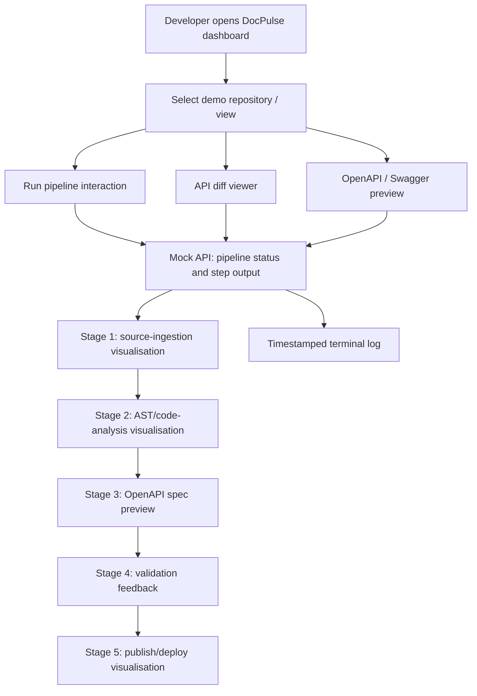

# ⚡ DocPulse — Automated API Documentation Agent

> **API Docs that write themselves.**  
> An automated CI/CD pipeline tool and developer dashboard that monitors backend codebases (Node.js/Express, Python/FastAPI), detects structural API changes via AST analysis, and automatically generates, validates, diffs, and deploys OpenAPI 3.1 specifications.


[](https://github.com/MokuLakshithReddy/Innovation-Challenge/stargazers)
[](https://github.com/MokuLakshithReddy/Innovation-Challenge/network/members)
[](https://github.com/MokuLakshithReddy/Innovation-Challenge/commits/main)

---

## Visual architecture



**Why it matters:** API changes can silently invalidate examples, SDKs, and integrations. DocPulse demonstrates how a developer could review a proposed spec update, inspect breaking changes, and follow a visible validation/publishing pipeline.

**Current scope:** The repository's API routes are mock endpoints for the pipeline, diff, and spec experience. The current app does not yet ingest an arbitrary Git repository, run AST analysis against its source, or deploy an OpenAPI document to an external provider. Treat the pipeline, terminal logs, API responses, and repository-health indicators as a product prototype—not a running CI/CD agent.

## 🌟 Key Features

- **🌗 Dual-Theme Engine (Dark & Light Mode)**
  - Fully adaptive modern design inspired by Vercel, Linear, and Stripe.
  - Deep obsidian dark mode with subtle neon accents & crisp, clean light mode.
  - Zero page-flash theme switching persisted via `localStorage`.

- **⚡ 5-Stage Interactive CI/CD Pipeline Visualizer**
  - **Stage 1: Code Ingestion & Webhook Trigger** — Detects push/PR events from GitHub/GitLab.
  - **Stage 2: AST & Code Analysis** — Parses route handlers, AST nodes, and type signatures.
  - **Stage 3: Spec Generation** — Synthesizes OpenAPI 3.1 JSON schemas automatically.
  - **Stage 4: Spec Validation** — Validates compliance, status codes, and schema rules.
  - **Stage 5: Deployment & Publishing** — Syncs specs to API gateways, Swagger Hub, and developer portals.
  - Interactive *"Run Pipeline"* button with real-time step progression.

- **💻 Real-Time Terminal & Streaming Console**
  - Mock log streaming directly from the documentation agent.
  - Filter by log level (`ALL`, `INFO`, `WARN`, `SUCCESS`).
  - Timestamped output, auto-scroll, copy logs, and console reset.

- **🔍 Intelligent API Diff Viewer**
  - Visualizes schema additions (`+ POST /api/v2/auth/mfa/verify`) in green.
  - Flags breaking deletions (`- DELETE /api/v1/legacy/session`) in red.
  - Highlights modified parameter types and request schemas.
  - Side-by-side **Split View** and inline **Unified View** toggle.

- **📖 Live Interactive OpenAPI / Swagger Preview**
  - Embedded API explorer with HTTP method badges (GET, POST, PUT, DELETE).
  - Collapsible route cards with parameter and response schemas.
  - Interactive **"Try it out"** test console with simulated live HTTP responses.
  - One-click copy or direct download of the generated `openapi-spec-v3.1.json`.

- **⌨️ Developer Productivity & Command Center**
  - Global Command Palette accessible via <kbd>Ctrl</kbd> + <kbd>K</kbd> / <kbd>⌘K</kbd>.
  - Instant navigation between repositories, branches, diffs, and settings.
  - Repository health scoring and drift alerts.

---

## 🛠️ Tech Stack

- **Framework:** [Next.js 16](https://nextjs.org/) (App Router, Turbopack)
- **Language:** [TypeScript](https://www.typescriptlang.org/)
- **Styling:** [Tailwind CSS v4](https://tailwindcss.com/) & Vanilla CSS custom properties
- **Icons:** [Lucide React](https://lucide.dev/)
- **Fonts:** Geist Sans & Geist Mono

---

## 🚀 Getting Started

### Prerequisites
- Node.js 18.x or higher
- npm 9.x or higher

### Installation

1. **Clone the repository:**
   ```bash
   git clone https://github.com/spurthireddy280/Innovation-Challenge.git
   cd Innovation-Challenge
   ```

2. **Install dependencies:**
   ```bash
   npm install
   ```

3. **Start the development server:**
   ```bash
   npm run dev
   ```

4. Open your browser and navigate to:
   ```
   http://localhost:3000
   ```

### Production Build

```bash
npm run build
npm run start
```

---

## 📁 Project Structure

```
├── src/
│   ├── app/
│   │   ├── api/agent/           # Mock API endpoints for pipeline, diffs, and specs
│   │   │   ├── diff/route.ts
│   │   │   ├── pipeline/route.ts
│   │   │   └── spec/route.ts
│   │   ├── globals.css          # Dual-theme design system (40+ CSS variables)
│   │   ├── layout.tsx           # Root layout with ThemeProvider
│   │   └── page.tsx             # Entry page loading AppShell
│   ├── components/
│   │   ├── dashboard/           # Overview metrics, activity feed & search modal
│   │   ├── diff/                # Split/unified API diff viewer
│   │   ├── icons/               # Custom brand icons (GitHub, GitLab)
│   │   ├── landing/             # Hero banner & integration overview
│   │   ├── layout/              # AppShell, TopNavbar & Sidebar
│   │   ├── pipeline/            # 5-stage stepper & live terminal console
│   │   └── specs/               # Interactive OpenAPI live documentation preview
│   ├── context/
│   │   └── ThemeContext.tsx     # Theme state management & localStorage persistence
│   └── data/
│       ├── mockData.ts          # Repositories, commits & metric mock data
│       └── pipelineData.ts      # Pipeline stages, logs, diffs & full OpenAPI spec
└── public/
```

---

## 📄 License

This project is licensed under the MIT License.
